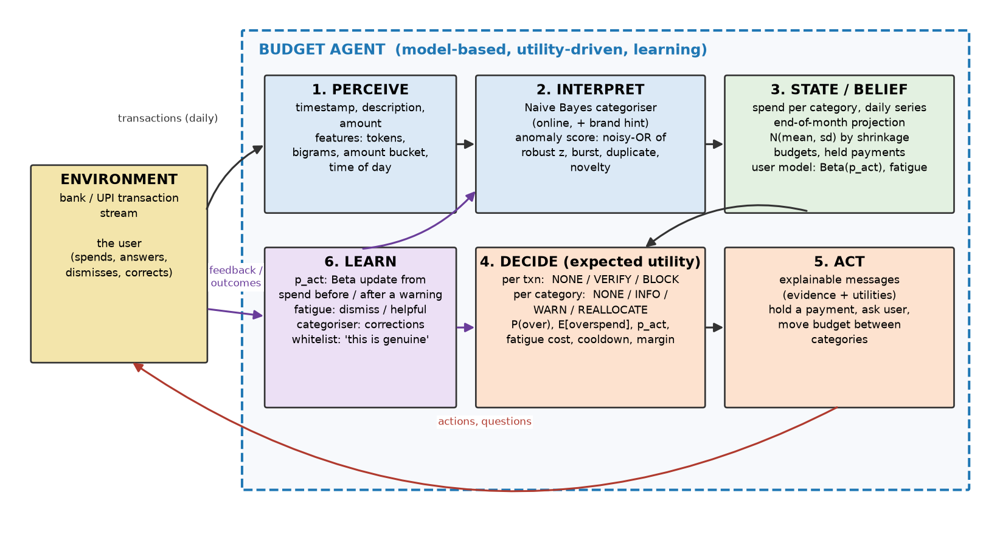
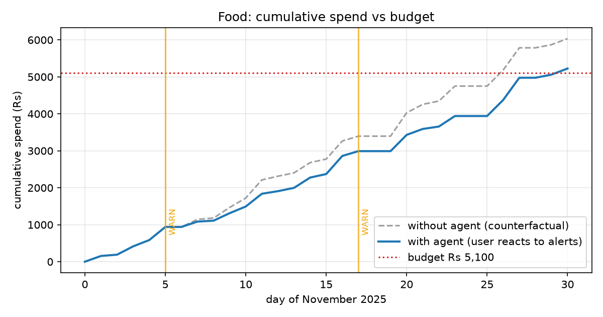
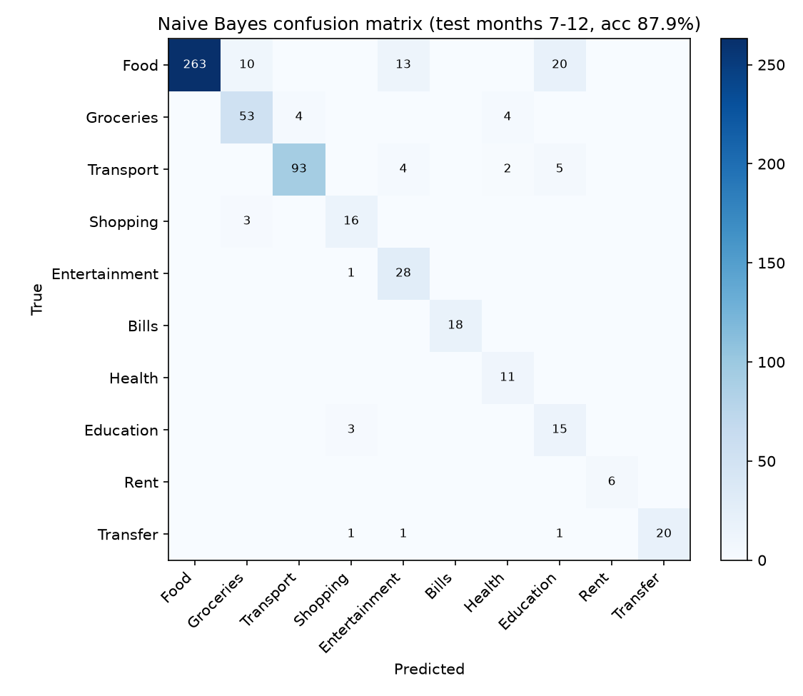
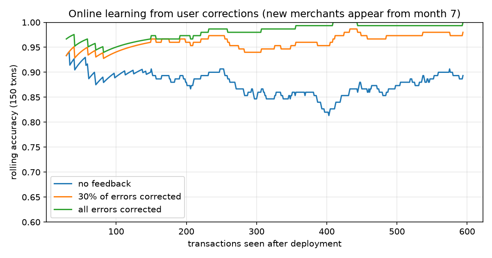
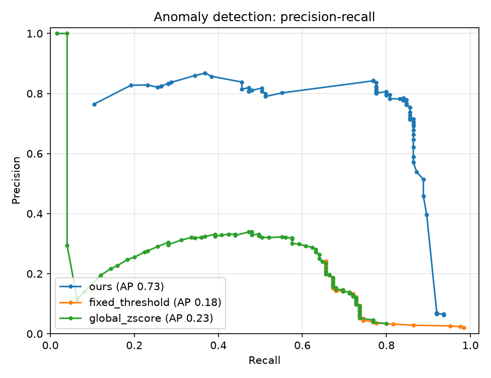
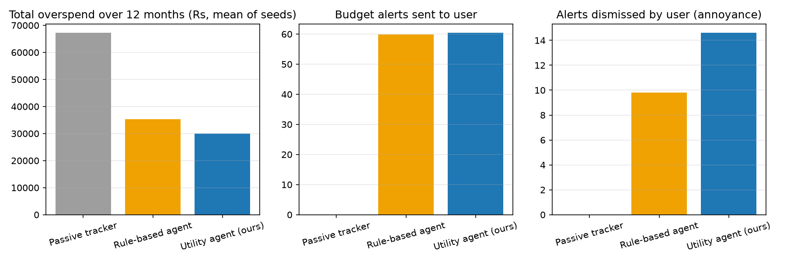
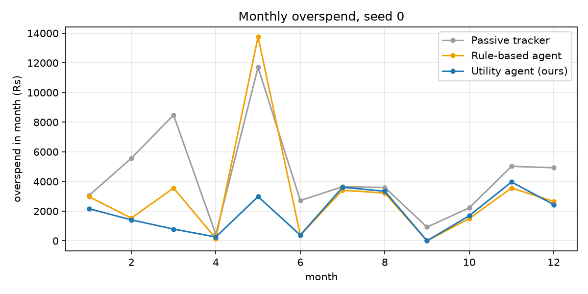
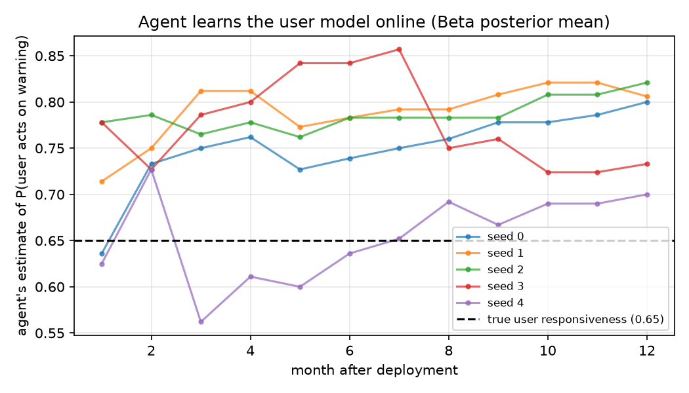
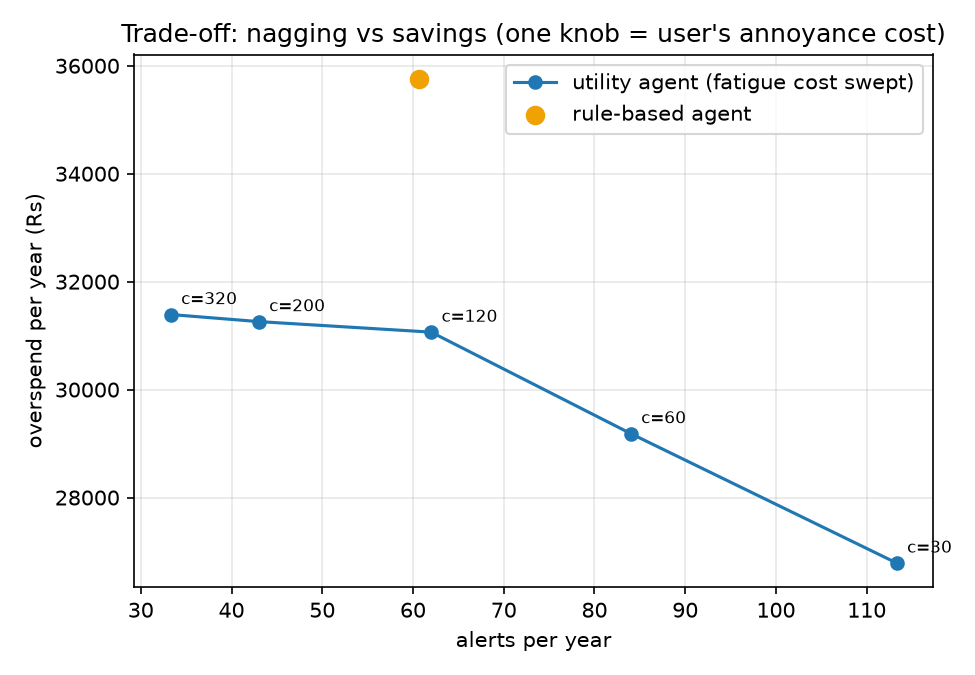

# SpendSense: a Smart Expense & Budget Agent

*AI agent project report. Code, data, logs and figures are in this folder; every
number below is reproduced by `python main.py evaluate` and `python main.py demo`.*

---

## 1. Problem definition

### 1.1 The real-life problem

Most people discover that they overspent only when the month is over. Bank and
UPI apps show a list of transactions; they do not say *which* category is
drifting, *whether* it will end over budget, or *what* to do about it. The
problems compound:

* Statement text is cryptic. Swiggy appears as `BUNDL TECHNOLOGIES`, Ola as
  `ANI TECHNOLOGIES`, a hostel mess as `UPI/ANNAPURNA HOTEL/8812..`.
* Spending is noisy. A single festival weekend is not a trend, but a slow
  drift in food delivery is.
* Fraud and mistakes hide in the stream: duplicate charges, card-testing
  bursts of small payments, night-time payments to unknown merchants.
* Nagging does not work. Budgeting apps that alert at a fixed threshold are
  switched off within weeks because most alerts are not actionable.

A good human money-coach would read the statement, keep a running picture of
every budget, speak up only when it matters, phrase the advice so it can be
acted on, and learn how much this particular person listens.

### 1.2 What the agent does

SpendSense is an agent that receives each day's transactions and

1. **categorises** them, including merchants it has never seen,
2. **forecasts** where every budget category will end the month, with
   uncertainty,
3. **scores** each payment for anomalies and decides whether to hold it,
4. **decides** per category whether to stay quiet, inform, warn, or re-plan the
   budget, by comparing the money an action can save with the annoyance it
   causes, and
5. **learns** online: how responsive the user is, how much they tolerate
   alerts, how to label new merchants, and which merchants are genuine.

### 1.3 PEAS description

| | |
|---|---|
| **Performance** | money kept within category budgets and within the monthly total; fraud losses avoided; minus the cost of interrupting the user (alerts, questions, false holds) |
| **Environment** | the user's transaction stream and the user. Partially observable (intent and future spending are hidden), stochastic, sequential, dynamic, single agent |
| **Actuators** | INFO / WARN messages, REALLOCATE proposals, VERIFY / BLOCK holds on a payment, ASK_CATEGORY questions |
| **Sensors** | timestamp, statement description and amount of each transaction; user feedback (helpful, dismiss, genuine, fraud, category corrections) |

In the Russell & Norvig taxonomy the agent is **model-based** (it maintains
beliefs about spend and the user), **utility-based** (every action is chosen by
expected utility) and **learning** (four components are updated online).

### 1.4 Scope

Personal budgets of one user; ten spending categories; decisions once per day
for budgets and per transaction for anomalies. Everything runs locally; no
data leaves the device. The environment is a realistic simulator (Section 5.1)
so that counterfactual outcomes and anomaly ground truth are available; the
agent also runs on a real statement export (`python main.py csv --path ...`).

---

## 2. Agent architecture



```mermaid
flowchart LR
  E[(Transaction stream<br/>+ user)] -->|daily transactions| P[1. Perceive<br/>tokens, bigrams,<br/>amount bucket, hour]
  P --> I[2. Interpret<br/>Naive Bayes category<br/>noisy-OR anomaly score]
  I --> S[3. State / belief<br/>spend, projections N(mean,sd),<br/>budgets, held payments,<br/>user model Beta(p_act), fatigue]
  S --> D[4. Decide<br/>expected utility:<br/>NONE/INFO/WARN/REALLOCATE<br/>NONE/VERIFY/BLOCK]
  D --> A[5. Act<br/>explainable messages,<br/>holds, questions,<br/>budget moves]
  A -->|actions| E
  E -->|feedback, outcomes| L[6. Learn<br/>p_act, fatigue,<br/>categoriser, whitelist]
  L --> S
```

**Internal state** (per month): spend and a daily series per category, the
current (possibly re-planned) budgets, the last two days of transactions for
burst and duplicate detection, payments on hold, alerts already sent with
their day and risk level, warnings awaiting outcome evaluation. **Persistent
state** across months: the categoriser's counts, the anomaly detector's
statistics and merchant whitelist, the forecaster's priors, the Beta posterior
of user responsiveness and the fatigue scale.

**Agent loop** (once per day):

```
process_day(date, transactions):
    for t in transactions (chronological):
        category, confidence  <- NaiveBayes.predict(t)
        score, evidence       <- AnomalyDetector.score(t, category, recent)
        action                <- FraudPolicy.choose(t, score)          # NONE | VERIFY | BLOCK
        if action != NONE: hold t (not counted until user confirms) and emit action
        else: spend[category] += amount
        if confidence < 0.6: emit ASK_CATEGORY
    for each category c:
        mean, sd <- Forecaster.project(c, spend[c], day, recent_rate)
        donors   <- categories almost surely under budget (for REALLOCATE)
        action   <- BudgetPolicy.choose(c, budget[c], spend[c], mean, sd, day, p_act, recent_alerts, cooldown, donors)
        emit action; record warnings for later outcome evaluation
    learn_from_outcomes(day)      # update Beta(p_act) for warnings that are 7 days old
feedback(action, response):      # dismiss | helpful | legit | confirm_fraud | reject_realloc | category:X
    update fatigue scale / whitelist / totals / categoriser accordingly
```

Three policies share this loop so the evaluation isolates the decision layer:
`utility` (ours), `rule` (warn at 80% of budget, flag at a fixed score) and
`none` (passive tracker).

---

## 3. Methodology: algorithms

### 3.1 Perception and features

A transaction is `(timestamp, description, amount)`. The description is
lower-cased, non-letters removed, generic tokens dropped (`upi`, `pos`, `ref`,
city names, ...). Features:

* unigrams and bigrams of the remaining tokens (weight 1),
* an amount bucket `amt_<floor(log2 amount)>` (weight 0.5),
* a time-of-day token `hr_morning / afternoon / evening / night` (weight 0.5),
* the guess of a small brand dictionary as a token `rule_<Category>` (weight 1).

The context features let the model separate a Rs 6,000 "transfer" (rent) from
a Rs 400 one (friend); the brand-dictionary token injects prior knowledge for
merchants the user has never paid, while the model *learns* how far to trust
it.

### 3.2 Categorisation: Multinomial Naive Bayes, online

$$P(c \mid x) \propto P(c)\prod_{f \in x} P(f \mid c)^{w_f}, \qquad
P(f \mid c) = \frac{N_{fc} + \alpha}{N_c + \alpha |V|}, \quad \alpha = 0.5$$

All quantities are running counts, so a user correction is an O(#features)
update with weight 3 (a human label is worth more than one noisy example).
The predicted probability doubles as a confidence; below 0.6 the agent asks the
user, which is how it bootstraps new merchants. Implemented from scratch in
`expense_agent/categorizer.py`. Baseline: a longest-match keyword dictionary of
brand names, which is what a typical budgeting app ships.

### 3.3 Anomaly scoring: noisy-OR of robust evidence

Four independent evidence sources are combined (`expense_agent/anomaly.py`):

$$s = 1 - (1 - s_{amount})(1 - s_{burst})(1 - s_{dup})(1 - s_{novel})$$

* $s_{amount} = \sigma\big(2.5\,(z - 3.2)\big)$ where
  $z = \dfrac{\log a - \text{median}_c}{1.4826\cdot\text{MAD}_c}$ is a robust
  z-score of log amount inside the predicted category. Median and MAD have a
  50% breakdown point, so one large legitimate purchase in history does not
  hide the next anomaly.
* $s_{burst} = \sigma\big(2(n-3)\big)$ for $n \ge 3$ payments to the same
  merchant within 30 minutes (card-testing pattern).
* $s_{dup} = 0.85$ if the same merchant received the same amount within 5
  minutes.
* $s_{novel} = 0.70$ if at least half the merchant tokens were never seen *and*
  the payment is between 00:00 and 06:00; 0.12 for a new merchant alone; 0.08
  for night alone.

Every score comes with a human-readable explanation (used in the messages).
Baselines: a fixed threshold on amount (3x the overall mean) and the same
robust z-score computed globally, ignoring category and context.

### 3.4 Forecasting: Bayesian shrinkage of the run-rate

From the user's labelled months the forecaster keeps, per category, the mean
monthly total $\mu_0$ and a robust spread $sd_0 = 1.4826\cdot\text{MAD}$ of
monthly totals (floored at 8% and capped at 40% of $\mu_0$). On day $d$ of a
month with $D$ days, with $f = d/D$:

$$\text{remaining} = w\,\Big[\tfrac12\big(\tfrac{spent}{f}-spent\big) + \tfrac12\, r_7 (D-d)\Big] + (1-w)\,\mu_0(1-f),\qquad w = f^{0.8}$$

$$\text{mean} = spent + \text{remaining}, \qquad sd = \sqrt{(sd_0(1-f))^2 + (0.15\,\text{remaining})^2} + 1$$

where $r_7$ is the average daily spend of the last seven days. Early in the
month the forecast is the prior; later it is the run-rate; the uncertainty
shrinks as the month progresses. Sparse categories (at most 8 payments a
month) use half the weight; fixed ones (rent, bills) use
$\max(spent, \mu_0)$.

### 3.5 Decision making: expected utility

**Budget actions** (`UtilityBudgetPolicy`). With projection $N(m, s)$ and
budget $B$, $z = (B - m)/s$:

$$P(\text{over}) = 1 - \Phi(z), \qquad
E[\text{over}] = s\,\varphi(z) + (m - B)\,(1 - \Phi(z))$$

A warning only saves money that is not yet spent, and only if the user acts:

$$\text{avoidable} = \min\big(E[\text{over}],\ 0.3\,(m - spent)\big)$$

$$\begin{aligned}
U(\text{WARN}) &= p_{act}\cdot\text{avoidable} - c_f\,\phi\,(1 + 0.5\,n_7)\\
U(\text{INFO}) &= 0.35\,p_{act}\cdot\text{avoidable} - 0.20\,c_f\,\phi\,(1 + 0.5\,n_7)\\
U(\text{REALLOCATE}) &= 0.8\,\min(m - B,\ \text{slack}) - c_r\\
U(\text{NONE}) &= 0
\end{aligned}$$

$c_f = 120$ is the user's annoyance cost of one alert (rupee-equivalent),
$\phi$ the learned fatigue scale, $n_7$ the alerts sent in the last seven
days, $c_r = 100$. The best action is taken only if it beats NONE by a margin
of 25, not before day 5 (too little evidence), and not within a 4-day
cooldown for the same category unless $P(\text{over})$ rose by 0.2.
REALLOCATE is a *re-planning* action for budgets that turned out unrealistic:
it is only on the table when $P(\text{over}) \ge 0.7$, the projection is at
least 20% over budget, at least 5 days remain, donors can spare a meaningful
amount, and the category has not been re-planned this month. A warning cannot
fix an unrealistic budget; moving slack from categories that are safely under
budget can, at the cost of one decision for the user.

**Fraud actions** (`UtilityFraudPolicy`). With $p = s^{2}$ (a calibration:
weak evidence below 0.5 is mostly noise and must compound), amount $a$ and a
follow-on loss $L = 150$ for fraud that goes unnoticed:

$$U(\text{NONE}) = -p\,(a+L),\quad
U(\text{VERIFY}) = -80 - 0.1\,p\,(a+L),\quad
U(\text{BLOCK}) = -(1-p)\,(150 + 0.5a)$$

A held payment is excluded from the budget totals until the user answers, so
a blocked fraud never triggers a budget alert.

**Rule baselines.** Warn once when 80% of the budget is spent before day 25;
flag a payment when its score is at least 0.5.

### 3.6 Learning

| What | How | Why |
|---|---|---|
| $p_{act}$, probability the user acts on a warning | Beta(3, 2) prior; 7 days after each WARN compare the spend rate after with a reference rate; success if below 85% of it. Reference = geometric mean of the pre-warning rate and the user's normal rate, to dampen regression to the mean | Enters $U(\text{WARN})$: an unresponsive user gets fewer warnings |
| fatigue scale $\phi$ | x1.15 on "dismiss", x0.92 on "helpful" (clamped to [0.5, 3]) | Encodes this user's tolerance |
| categoriser | weighted online Naive Bayes update from answers and corrections | New merchants and aliases |
| merchant whitelist | tokens of a payment confirmed genuine are added to the known set | Stops repeated novelty flags |

### 3.7 Implementation

Python 3, about 1,800 lines including tests, dependencies numpy, pandas, matplotlib only; all
learning and decision algorithms are written from scratch. Modules:
`data_gen.py` (environment), `categorizer.py`, `anomaly.py`, `forecaster.py`,
`decision.py`, `agent.py`, `simulation.py` (simulated user and month runner),
`evaluate.py`, `demo.py`, `diagram.py`. Smoke tests in `tests/test_smoke.py`.

---

## 4. Demonstration

`python main.py demo` trains the agent on six labelled months (569
transactions), proposes budgets at 110% of the historical mean, then runs
November 2025 day by day with a simulated user. Full log:
[outputs/demo_log.txt](outputs/demo_log.txt). Excerpts, with the agent's own
reasoning:

```
--- Sun 02 Nov 2025 ---
  11:39  Rs   6,000  PG RENT PAYMENT 3992005081             -> Rent           99%
  20:57  Rs   3,375  PVR CINEMAS                            -> Entertainment  98%  <risk 100%>
  >> [BLOCK] Block and alert user: Rs 3,375 'PVR CINEMAS' at 02 Nov 20:57
     (risk 100%: amount is 7.3 robust-SD above normal for this category).
     utilities: NONE=-3524.7, VERIFY=-432.5, BLOCK=-0.1

--- Wed 05 Nov 2025 ---
  >> [WARN] Food: Rs 940 spent by day 5 (18% of Rs 5,100). Projected Rs 5,001 +/- 897;
     46% chance of overspending by about Rs 311. Keep Food under Rs 166/day for the remaining 25 days.
     utilities: NONE=0.0, WARN=66.4, INFO=41.2, REALLOCATE=None  (p_act=0.6)

--- Fri 07 Nov 2025 ---
  >> [INFO] Shopping: Rs 640 spent by day 7 (28% of Rs 2,250). Projected Rs 2,295 +/- 677;
     53% chance of overspending by about Rs 293.
     utilities: NONE=0.0, WARN=10.1, INFO=28.4, REALLOCATE=None  (p_act=0.6)

--- Mon 10 Nov 2025 ---
  >> [REALLOCATE] Education: projected Rs 639 vs budget Rs 200 (P(over) = 100%). Other categories
     are under budget; suggest moving Rs 450 from Groceries to Education.
     utilities: NONE=0.0, WARN=-170.7, INFO=-26.6, REALLOCATE=250.8  (p_act=0.6)

--- Tue 18 Nov 2025 ---
  03:41  Rs   1,710  CARD 7337 CRYPTOX EXCHANGE KOCHI       -> Transfer       25%  <risk 72%>
  >> [VERIFY] Hold and ask user to confirm: Rs 1,710 'CARD 7337 CRYPTOX EXCHANGE KOCHI' at 18 Nov 03:41
     (risk 72%: merchant never seen before; payment between midnight and 6 am).
  >> [ASK_CATEGORY] Not sure about 'CARD 7337 CRYPTOX EXCHANGE KOCHI' (Rs 1,710): guessed Transfer (25%).

--- Tue 25 Nov 2025 ---
  >> [WARN] Groceries: Rs 3,110 spent by day 25 (91% of Rs 3,400). Projected Rs 3,824 +/- 259;
     95% chance of overspending by about Rs 430. Keep Groceries under Rs 58/day for the remaining 5 days.
```

Month summary printed by the agent (budget = original, adjusted = after the
one re-plan, no-agent = counterfactual replay of the same month):

```
  category         budget  adjusted     spent  no-agent   status
  Education           200       650       460       460   OVER by Rs 260
  Food              5,100         -     5,226     6,036   OVER by Rs 126
  Groceries         3,850     3,400     3,315     3,465   ok
  Shopping          2,250         -     2,170     2,170   ok
  ...
  Category overspend vs original budgets: with agent Rs 386, without agent Rs 1,196
  Alerts: 5 budget alerts, 1 reallocations; user responded 4x, dismissed 0x
  Anomalies: 5 present, 5 caught, 1 false flags
  Learned user model: P(acts on warning) = 0.75, fatigue scale = 0.92
```



The timeline shows the mechanism: two warnings on days 5 and 17, the user
cuts food spending for a week after each, and the month ends Rs 810 lower
than the counterfactual.

Running on a real statement export: `python main.py csv --path data/statement_unlabelled.csv`.

---

## 5. Evaluation

### 5.1 Set-up

**Environment.** A simulator of a student's UPI and bank transactions in
Kerala (`expense_agent/data_gen.py`): ten categories with lognormal amounts,
Poisson daily counts, weekend effects, scheduled rent and bills, month-level
variation (lognormal, sigma 0.12) with occasional shock months (x1.6 in one
category), 70 merchants with 2 to 3 statement aliases each, and 17 "late"
merchants that only appear after month 6. Four anomaly types are injected on
5% of days: large amounts, bursts of 4 to 6 rapid payments, unknown merchants
at night, duplicate charges (about 2% of transactions).

**Counterfactuals.** Each day is generated from a seed derived from
(simulator seed, date). The user's reaction to the agent only *scales*
amounts, so the same month can be replayed without the agent to obtain the
exact overspend that would have occurred. Overspend is always measured
against the **original** budgets, so a reallocation cannot flatter the agent.

**Simulated user.** Hidden traits: acts on a WARN with probability 0.65
(INFO: 0.45 of that), spending 30% less in that category for a week; mostly
ignores and starts dismissing alerts after more than three in a week; accepts
re-plans 80% of the time; answers fraud checks truthfully; answers 70% of
category questions and spots 10% of remaining mislabels.

**Protocol.** Six labelled months for training, then twelve live months,
five seeds, three policies that share the same perception and differ only in
the decision layer.

### 5.2 E1: categorisation

641 training transactions (months 1-6), 595 test transactions (months 7-12),
158 of them from merchants never seen in training.

| Model | Accuracy (all) | Seen merchants | Unseen merchants |
|---|---|---|---|
| **Naive Bayes, ours** (text + amount/time + brand-dictionary hint) | **87.9%** | **100.0%** | **54.4%** |
| Naive Bayes without the brand hint | 79.5% | 99.3% | 24.7% |
| Naive Bayes, text only | 80.0% | 99.8% | 25.3% |
| Keyword rules (brand dictionary alone) | 54.1% | 56.1% | 48.7% |

Rules alone fail on statement aliases (`BUNDL TECHNOLOGIES`); learning alone
fails on merchants it has never seen; combining the dictionary's guess as a
*feature* gives the best of both. Amount and time features help little on
their own here (the ablation differs by 0.5 points) but they are what
separates rent from a friend transfer. With online learning from corrections
the accuracy on the last 300 test transactions rises from 87.7% (no feedback)
to 98.0% when the user corrects 30% of errors and 99.7% when all are
corrected.




Remaining confusions are explainable: `AMAZON KINDLE` (Education) vs Amazon
(Shopping), and new restaurants vs groceries when only the amount is
informative.

### 5.3 E2: anomaly detection

6,043 test transactions over 5 seeds x 12 months, 125 anomalous. Scores use
the *predicted* category, so categorisation errors are included.

| Detector | Precision@0.5 | Recall@0.5 | F1@0.5 | Average precision | Flags raised |
|---|---|---|---|---|---|
| **Ours (noisy-OR, per-category robust z, burst, duplicate, novelty)** | **0.78** | **0.83** | **0.81** | **0.73** | 133 |
| Fixed threshold (amount > 3x mean) | 0.24 | 0.66 | 0.35 | 0.18 | 342 |
| Global robust z-score | 0.29 | 0.61 | 0.40 | 0.23 | 260 |

Recall by type: duplicates 100%, unknown-merchant-at-night 100%, large
amounts 80%, bursts 65% (the first two payments of a burst look normal by
construction; the detector flags from the third onward, so per *event* recall
is near 100%). Category-aware scoring is what matters: a Rs 1,200 grocery
bill is normal, a Rs 1,200 chai is not, and a global threshold cannot tell.



### 5.4 E3: the agent against baselines (12 months x 5 seeds, means)

| Metric | Passive tracker | Rule-based agent | **Utility agent (ours)** |
|---|---|---|---|
| Category overspend vs original budgets (Rs / year) | 67,214 | 35,292 | **30,039** |
| Overspend reduction vs passive | 0% | 47.5% | **55.3%** |
| Net overspend of the whole monthly budget (Rs / year) | 27,629 | 6,405 | **3,771** |
| Budget alerts per year | 0 | 59.8 | 60.4 |
| Alert precision (category truly heading over budget) | - | 57.4% | **70.6%** |
| Alerts dismissed by the user | 0 | 9.8 | 14.6 |
| Alerts the user acted on | 0 | 35.2 | 24.0 |
| Budget re-plans | 0 | 0 | 31.8 |
| Anomalies caught (of 25 present) | 0 | 21.0 | **22.0** |
| False fraud flags | 0 | 5.0 | 7.4 |
| Learned P(user acts) after 12 months (true 0.65) | 0.60 (prior) | 0.84 | 0.77 |
| Category questions asked, month 1 -> month 12 | 0 | 7.8 -> 0.4 | 7.0 -> 0.6 |




Reading the table honestly:

* With the **same number of alerts**, the utility agent saves Rs 5,250 more
  per year than the rule-based agent against category budgets and Rs 2,600
  more against the monthly total, and its alerts are right 71% of the time
  instead of 57%. Its advantage comes from timing (it can warn on day 5 when
  the projection is clear, or stay quiet on day 24 when nothing can be
  saved) and from re-planning unrealistic budgets.
* The rule agent gets more *responses* (35 vs 24) because its alerts are
  spread out (one per category per month), whereas ours cluster in bad weeks
  and trigger the simulated user's annoyance. The fatigue term already
  penalises clustering; raising it is exactly the knob explored in E4.
* The learned responsiveness overshoots the true 0.65. The estimate is
  observational: warnings fire after unusually high spending, which falls
  back on its own (regression to the mean). The geometric-mean reference
  dampens but does not remove this. A proper fix is to randomly withhold a
  small fraction of warnings and compare outcomes (a built-in A/B test).
* Almost every month still has *some* overspend. Most of it is in tiny
  categories (an Education budget of Rs 200 is breached by one textbook);
  the agent's re-plan handles this within the month but the strict metric
  still counts it.



### 5.5 E4: sensitivity to the one behavioural knob

The fatigue cost $c_f$ encodes how much the user dislikes being interrupted.
Sweeping it traces the trade-off between nagging and savings (3 seeds):

| fatigue cost | alerts / year | overspend / year (Rs) | dismissed |
|---|---|---|---|
| 30 | 113.3 | 26,787 | 55.3 |
| 60 | 84.0 | 29,185 | 30.3 |
| **120 (default)** | **62.0** | **31,065** | **15.7** |
| 200 | 43.0 | 31,260 | 11.0 |
| 320 | 33.3 | 31,391 | 6.3 |
| rule-based agent | 60.7 | 35,760 | - |



The rule-based agent sits above the frontier: for the same 60 alerts it
leaves Rs 4,700 more overspend. A user who hates notifications can move to
33 alerts a year and still beat the rule agent by Rs 4,400.

### 5.6 Limitations

* **Synthetic environment.** Real statements are messier and real users less
  regular. The simulator was necessary for counterfactual overspend and
  anomaly ground truth; the next step is a study on anonymised real
  statements, for which the CSV mode exists.
* **Confounded responsiveness estimate** (Section 5.4); randomised holdout
  warnings would fix it.
* **Naive Bayes independence.** New-merchant accuracy (54%) is the weakest
  number; a linear model over the same features or a sentence embedding of
  the description would help.
* **Hand-set utility constants** (annoyance cost, follow-on loss, false-block
  cost). They are interpretable in rupees and E4 shows the agent degrades
  gracefully, but they should be elicited from the user.
* **Held payments** are excluded until answered; a real deployment needs a
  timeout.

---

## 6. Conclusion and future work

The agent turns a raw transaction stream into timely, explainable
interventions and improves with use. Against a passive tracker it removes
55% of category overspend and 86% of net monthly overspend; against a
rule-based agent with the same alert budget it saves more, is right more
often, and catches more anomalies. Every decision is backed by an explicit
expected-utility computation that the user can read in the message.

Future work: randomised holdout warnings for an unbiased causal estimate of
responsiveness; a contextual bandit for *when in the day* to deliver an alert;
a richer text model for new merchants; shared "misc" envelopes for tiny
categories; and a user study on real statements.

---

## 7. How to run

```bash
pip install -r requirements.txt
python main.py demo            # one month, day by day
python main.py evaluate        # all experiments -> outputs/RESULTS.md and figures
python main.py generate        # sample datasets in data/
python main.py csv --path data/statement_unlabelled.csv
python tests/test_smoke.py
```

## 8. References

1. S. Russell and P. Norvig, *Artificial Intelligence: A Modern Approach*, 4th ed., Ch. 2 (agents), Ch. 16 (utility), Ch. 20 (Bayesian learning).
2. C. D. Manning, P. Raghavan and H. Schütze, *Introduction to Information Retrieval*, Ch. 13 (Multinomial Naive Bayes).
3. J. Pearl, *Probabilistic Reasoning in Intelligent Systems*, 1988 (noisy-OR).
4. P. J. Rousseeuw and C. Croux, "Alternatives to the median absolute deviation", *JASA*, 1993 (robust scale, MAD).
5. C. Leys et al., "Detecting outliers: do not use standard deviation around the mean, use absolute deviation around the median", *J. Exp. Soc. Psych.*, 2013.
6. A. Gelman et al., *Bayesian Data Analysis*, Ch. 2 (Beta-Binomial model, shrinkage).
